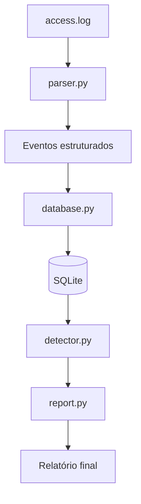

# SIEM Lite — Python + SQL

Projeto individual de estudo em **Cibersegurança**, desenvolvido com Python e SQLite para praticar análise de logs, detecção de atividades suspeitas e geração de relatórios de segurança.

## 🎯 Objetivo

O SIEM Lite é uma ferramenta de monitoramento e análise de eventos de segurança inspirada no funcionamento de sistemas SIEM (*Security Information and Event Management*).

O objetivo é desenvolver, de forma incremental, uma aplicação capaz de processar registros de acesso, armazenar eventos em um banco de dados, identificar comportamentos suspeitos e apresentar os resultados em relatórios.

O projeto está em desenvolvimento e faz parte dos meus estudos práticos em segurança da informação, especialmente nas áreas de SOC e análise de logs.

## ⚙️ Funcionalidades

- **Leitura e parsing de logs:** processamento de registros de acesso e conversão em eventos estruturados.
- **Armazenamento em banco de dados:** utilização do SQLite para persistir e consultar os eventos.
- **Detecção de força bruta:** identificação de múltiplas tentativas de login malsucedidas a partir de um mesmo endereço IP.
- **Geração de relatórios:** apresentação de informações sobre os eventos processados e os resultados das detecções.
- **Geração de logs simulados:** criação de conjuntos de dados reproduzíveis, com tráfego normal e cenários de ataque, para testar os detectores.

Os cenários simulados incluem brute force, SQL Injection, path traversal, enumeração de diretórios e acessos administrativos.

## 🏗️ Arquitetura

O processamento está organizado em módulos, separando as responsabilidades de cada etapa.



### Responsabilidade dos módulos

- `main.py`: coordena a execução do programa.
- `parser.py`: interpreta as linhas do arquivo de log.
- `database.py`: gerencia o armazenamento e as consultas ao banco SQLite.
- `detector.py`: executa as consultas e regras de detecção.
- `report.py`: organiza e apresenta os resultados.
- `generate_logs.py`: gera logs simulados para testes, caso esse seja o nome do arquivo utilizado no projeto.

## 🚀 Execução

Com o Python instalado e o ambiente configurado, execute no terminal:

```bash
python main.py access.log
```

O arquivo de log deve estar no caminho esperado pelo programa. Consulte a estrutura do projeto para verificar a localização correta dos arquivos.

## 🧪 Testes e simulação

O gerador de logs permite criar cenários controlados para avaliar o comportamento dos detectores, comparar resultados e identificar limitações nas regras implementadas.

Os registros são simulados para fins educacionais, sem necessidade de realizar ataques contra sistemas reais.

## 📚 Tecnologias utilizadas

- **Python:** processamento de logs e implementação das regras de detecção.
- **SQL:** consultas e análise dos eventos armazenados.
- **SQLite:** persistência dos dados.
- **Git e GitHub:** versionamento e documentação do projeto.

## 📌 Status do projeto

**Em desenvolvimento.**

O projeto está sendo construído gradualmente, com foco em aprendizado prático, organização modular e evolução das regras de detecção.

Novas funcionalidades e melhorias serão incorporadas conforme o desenvolvimento avançar.

## 🎓 Motivação

Este é um projeto individual criado para reforçar meus estudos em Ciência da Computação e aprofundar meus conhecimentos em cibersegurança por meio da prática.

Mais do que implementar funcionalidades, a proposta é compreender como eventos de segurança podem ser processados, armazenados e analisados para auxiliar na identificação de atividades suspeitas.
